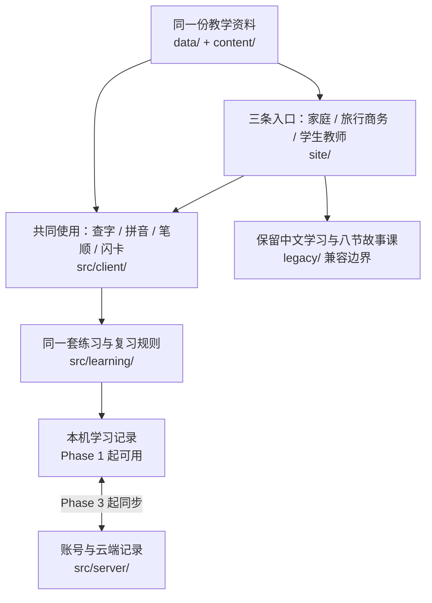

# HanziFun 文件架构说明

2026-10-24 · 面向产品阅读 · 对照 [SPEC](SPEC.md) 与 [任务总表](TASKS.md)。

**这是一份目标结构图。** 它细化已有规划，没有开始搬文件、合并工作树或实现功能。文中的新文件名是建议命名，由 HF-01 冻结后执行；现有代码仍在原位置。

本版已同步最新确认：**单字页增加 Information；`/stroke-order/` 保持独立；新增独立 `/pinyin-chart/`；暂不考虑书法。** 独立部件专题、词语详情和简繁导读仍是调研候选，不自动进入这份已确认结构。

开发顺序已改为：**Phase 1 免费主站上线 → Phase 2 四工具、正式 Blog 与 HSK 扩充 → Phase 3 登录、云同步与订阅。** 前两阶段共用静态页面、浏览器运算和本机学习记录，不等待 `src/server/`。单字采用两级内容，同一模板先发布合格标准版，再升级黄金版。

## 1. 先理解这套结构在做什么

整个网站有三条学习入口：**家庭儿童、旅行商务、学生教师**。三条入口共用字典、字卡、复习规则和新版学习记录。用户从餐厅场景收藏的「水」，回到字典或学习中心时，看到的仍是同一个字和同一份记录。

文件分成五类：**页面长什么样、功能如何运行、教学内容是什么、旧版如何保留、如何检查和发布**。这些是同一个项目里的不同文件夹。

最需要区分的两件事：

- `data/` 存汉字、读音、词表等公共教学资料。用户的收藏、练习历史和账号资料不存进这个文件夹，也不打包到公开网站里。
- `legacy/` 是建议的旧中文源码存放位置。用户使用的入口仍是 `/zh/` 和原有故事链接，文件夹名称不等于网址。



旧中文系统原有的字卡记录、故事记录仍保留，经过用户选择后导入；不把故事测验成绩直接换算为新版闪卡掌握度。

## 2. 用户看到的网站栏目

下面是**页面与网址**，用于核对产品范围。下一节才是开发文件目录。

```text
HanziFun
├── 首页 /                               七个已确认板块，沿用 C 方案
├── Printable resources /worksheets/    通用练习纸；旧 /kids/worksheets/ 301至此
│
├── Learning Paths 学习路径
│   ├── Kids & Families /kids/           家庭儿童
│   │   ├── /kids/stories/               八节已有中文故事的英文介绍入口
│   │   └── /kids/stories/{slug}/        单课介绍 → 对应中文播放器
│   ├── Travel & Business /scenarios/    旅行商务
│   │   ├── /scenarios/travel/restaurant/     餐厅场景
│   │   └── /scenarios/business/icebreakers/ 商务礼貌开场
│   └── Students & Teachers /academic/  学生教师
│       ├── /academic/hsk-2/             HSK 2.0，先首级再扩充
│       ├── /academic/hsk-3/             HSK 3.0，先首级再扩充
│       └── /academic/textbooks/         教材说明；授权明确后才做映射
│
├── Visual Dictionary 视觉字典
│   ├── /dictionary/                    全部已收录字与搜索
│   ├── /dictionary/{字}/               单字解释、视觉记忆、Information、例句、听音
│   ├── /dictionary/pinyin/             按拼音找汉字的索引
│   ├── /dictionary/radicals/           部首与部件说明
│   ├── /dictionary/compare/            易混字比较
│   ├── /dictionary/top-100/            首版待发布，后续有依据的入门集
│   ├── /stroke-order/                 独立笔顺页；?char=水 可直接选择「水」
│   └── /pinyin-chart/                 独立拼音表；音节、声调、发音和例字
│
├── Flashcards 闪卡 /flashcards/
│   ├── /flashcards/decks/              卡组列表
│   ├── /flashcards/decks/{slug}/       某组字卡与练习入口
│   ├── /flashcards/my-words/           我的收藏词库
│   └── /flashcards/teacher/            后续教师私人组卡
│
├── Fun & Culture 文化工具 /tools/
│   ├── chinese-name-generator/         中文名
│   ├── chinese-menu-decoder/           中文菜单
│   ├── zodiac-elements-calculator/     生肖与年干五行
│   └── tattoo-character-checker/       纹身文字释义
│
├── Blog /blog/                         文化、旅行商务、家庭学习文章
├── Search /search/                     全站搜索结果
├── My learning /account/               学习中心，首版游客也能使用
├── Sign in /sign-in/                   Phase 3 接真实登录
├── Pricing /pricing/                   Phase 3 接订阅；前两阶段说明免费范围
├── 中文 /zh/                           保留现有中文学习体验
└── 关于、联系、隐私、条款、资料来源、404
```

Visual Dictionary 下拉菜单包含 **All Characters / Stroke Order / Pinyin Chart / HSK 2.0 Library / HSK 3.0 Library**。HSK 两个入口继续链接 `/academic/hsk-2/` 和 `/academic/hsk-3/`，共用已有页面，不另建第二份同义字库。2026-10-28 Owner决定将原Learning guides导航替换为 **Chinese Culture** 下拉，分别链接 `/tools/` 与 `/blog/`，不改变这两个页面的地址。

上图的 Visual Dictionary 是导航分组，**不表示这些网址都放在 `/dictionary/` 下面**。最新确认的页面职责是：

| 页面 | 主地址 | 用户来这里做什么 |
|---|---|---|
| 单字详情 | `/dictionary/{字}/` | 查这个字的含义、拼音、简繁、Kanji 补充信息、笔顺与用法 |
| Stroke Order | `/stroke-order/` | 选字、看逐笔动画和静图、学习基本笔顺规则 |
| Pinyin Chart | `/pinyin-chart/` | 查音节、区分声调、听发音，再进入相关汉字 |
| 拼音索引 | `/dictionary/pinyin/` | 已知某个读音，查有哪些已收录汉字 |

笔顺页和拼音表分别使用独立标题、正文与主地址。单字页保留自己的笔顺与读音展示，通过正常链接进入工具；工具也能回到单字页。它们共用数据与组件，不复制字库。

文化工具、Blog、教师组卡、登录、定价在首版保留入口，并说明实际可用范围。Phase 2 交付四个可用工具、3–5 篇正式 Blog 及 HSK 分批扩充；账号、同步和订阅在 Phase 3，教师组卡可选。**存在一个页面，不代表功能已完成。** Blog 样稿和空占位页仍 noindex；达到 Tier 2 的真实字页不因缺插画或长故事而 noindex。

## 3. 开发文件放在哪里

阶段标记：**[首版] = Phase 1，包含正式上线；[引流] = Phase 2；[账号] = Phase 3 的登录/同步/订阅；[可选] = Phase 3 的教师扩展。** 只在对应阶段建立实际需要的文件，见第 7 节。

以下列出主要文件和目录；`{字}`、`{slug}` 表示生成页面时替换的内容，不需要逐个手写网页。

```text
汉字饭hanzifun/
│
├── site/                               页面外观与页面生成规则 [首版]
│   ├── layouts/base.html               全站公共页面骨架
│   ├── components/                     共享导航、页脚、字卡展示等
│   │   └── character-information.html  单字 Information 信息区
│   ├── pages/
│   │   ├── home.html                   七段首页
│   │   ├── kids/                       家庭入口、故事介绍、打印页模板
│   │   ├── scenarios/                  旅行商务入口与场景详情模板
│   │   ├── academic/                   两套 HSK、教材说明模板
│   │   ├── dictionary/                 字库、单字详情和索引模板
│   │   │   ├── index.html             字典首页与查字入口
│   │   │   ├── character.html         所有单字共用的详情模板
│   │   │   ├── pinyin.html            按拼音找汉字
│   │   │   ├── radicals.html          部首与部件说明
│   │   │   ├── compare.html           易混字比较
│   │   │   └── top-100.html           后续有依据的入门集
│   │   ├── stroke-order.html           独立 /stroke-order/ 页面
│   │   ├── pinyin-chart.html           独立 /pinyin-chart/ 页面
│   │   ├── flashcards/                 卡组、练习、我的词库、教师页
│   │   ├── tools/                      四项文化工具页面
│   │   ├── blog/                       文章列表与文章详情模板
│   │   ├── account.html                我的学习中心
│   │   ├── sign-in.html                登录页
│   │   ├── pricing.html                定价与服务范围页
│   │   ├── search.html                 搜索结果页
│   │   ├── about.html                  产品介绍
│   │   ├── contact.html                联系方式
│   │   ├── privacy.html                隐私说明
│   │   ├── terms.html                  使用条款
│   │   ├── data-sources.html           数据来源与归属说明
│   │   └── 404.html                    页面不存在的提示
│   ├── styles/                         C 方案配色、字体、布局、手机适配
│   ├── routes.mjs                      读取路由契约，生成页面地址
│   └── release.json                    本次发布选择开放的功能范围
│
├── src/                                功能如何运行
│   ├── client/                         浏览器里运行的功能
│   │   ├── navigation.mjs              导航、下拉菜单、手机菜单 [首版]
│   │   ├── search.mjs                  搜索汉字、拼音、英文 [首版]
│   │   ├── dictionary.mjs              字页读音切换、收藏、练习入口 [首版]
│   │   ├── strokes.mjs                 笔顺播放与逐笔查看 [首版]
│   │   ├── pinyin-chart.mjs            音节/声调选择、筛选及例字入口 [首版]
│   │   ├── audio.mjs                   听音、停止、声音开关 [首版]
│   │   ├── flashcards.mjs              翻卡与评价的界面操作 [首版]
│   │   ├── learning-center.mjs         进度、历史、续练、导出 [首版]
│   │   ├── scenario.mjs                场景点字、整句听音、收藏 [首版]
│   │   ├── storage/                    本机保存、旧记录导入 [首版]
│   │   ├── auth.mjs                    登录、退出、身份状态 [账号]
│   │   ├── sync.mjs                    本机与云端同步 [账号]
│   │   ├── tools/                      四工具规则/检索，浏览器运行 [引流]
│   │   ├── teacher-decks.mjs           教师私人组卡 [可选]
│   │   └── billing.mjs                 订阅结账与账单入口 [账号]
│   ├── learning/                       所有新版学习入口共用的规则 [首版]
│   │   ├── scheduler.mjs               决定某张卡什么时候再复习
│   │   ├── session.mjs                 练习顺序、当前位置、完成状态
│   │   ├── events.mjs                  记录一次评价，避免重复计数
│   │   └── repository.mjs              统一读写学习记录的约定
│   └── server/                         服务器处理的私人数据与权限
│       ├── api/                        登录、同步、收藏、导入导出 [账号]
│       ├── auth/                       身份、会话与用户权限 [账号]
│       ├── sync/                       多设备合并与冲突处理 [账号]
│       ├── adapters/                   对接选定的身份/数据库服务 [账号]
│       ├── db/migrations/              数据库结构与升级脚本 [账号]
│       ├── teacher-decks/              私人卡组与版本 [可选]
│       └── billing/                    支付通知校验与付费权益 [账号]
│
├── data/                               可追溯的公共教学资料
│   ├── characters.json                 唯一汉字、基础信息、Tier 与发布/审核状态
│   ├── kanji-relations.json            日语对应字形、证据及核验状态
│   ├── pinyin/
│   │   └── syllables.json             拼音表的合法音节、声调、例字/音频关联
│   ├── words.json                      词语及其组成字
│   ├── readings.json                   读音、义项、音频关联
│   ├── examples.json                   例词、例句及来源
│   ├── hsk/
│   │   ├── hsk-2/                      HSK 2.0 的版本与等级归属
│   │   └── hsk-3/                      HSK 3.0 的版本与等级归属
│   ├── decks/                          四个基础组、场景组、HSK 组定义
│   ├── strokes/                        笔顺资源清单与字形标准
│   ├── licenses/                       数据的许可与归属文件
│   ├── sources.lock.json               每批数据的来源、版本与校验值
│   └── coverage.json                   去重覆盖、Tier 2可用/Tier 1增强与可发布数
│
├── content/                            人工编写、审核的教学和网站内容
│   ├── site/                           首页文案、FAQ、介绍与说明文案
│   ├── pinyin/                         拼音表使用说明、声调与拼写教学内容
│   ├── visual-notes/                   Tier 2短助记；Tier 1深入助记/插画关联
│   ├── scenarios/
│   │   ├── travel/restaurant.json      餐厅短句、英文解释、关联字词
│   │   └── business/icebreakers.json    商务礼貌开场短句
│   ├── stories/index.json              英文介绍、slug → 旧 lessonId 映射
│   ├── blog/                           三方向正式文章，首批3–5篇 [引流]
│   ├── worksheets/                     首版6字样本；两组正式打印卡 [引流]
│   └── tools/                          审核后的姓名、菜名、历法资料 [引流]
│
├── public/                             经过审核、允许公开的成品素材
│   └── site-assets/                    新英文资源使用独立网址前缀
│       ├── brand/                      印章、字标、站点图标
│       ├── images/                     首页与教学插画的发布版本
│       ├── audio/                      新版需要的审核音频
│       └── strokes/                    许可允许公开的笔画资源
│
├── legacy/                             整合后中文源码的目标位置 [首版]
│   ├── index.html / app.js / styles.css 旧中文闪卡界面
│   ├── characters.js / storage.js      旧字卡顺序与旧记录处理
│   ├── story.html / story.js / story.css 中文故事播放器
│   ├── lessons.js                      八节课定义，以整合后清单为准
│   ├── audio.js / audio-manifest.json   旧声音功能与音频清单
│   ├── audio/                          既有静态语音
│   └── assets/lessons/                 已有故事图片、无声视频等
│
├── scripts/                            导入、生成、检查、打包的工具
│   ├── build-site.js                   扩展现有入口，汇总公开发布产物
│   ├── build/                          英文页面/中文兼容/资源输出规则
│   ├── import-data/                    来源数据转换与版本锁定
│   ├── validate/                       路由、引用、数据覆盖、许可检查
│   └── 现有语音与故事处理脚本          按原有制作流程保留
│
├── tests/                              保留旧测试，按功能增加验证
│   ├── 现有中文与故事测试              整合后继续通过
│   ├── learning/                       复习规则、会话、重复提交
│   ├── data/                           来源、词表、笔顺、关联完整性
│   ├── storage/                        保存、刷新、旧记录导入
│   ├── e2e/                            用户从查字到复习的浏览器流程
│   └── server/                         身份、同步、权限、支付 [账号/扩展]
│
├── docs/hanzifun-rebuild/               施工说明与执行证据
│   ├── FILE_ARCHITECTURE.md             你正在读的结构说明 [已存在]
│   ├── SPEC.md / TASKS.md / tasks/      功能要求与 18 个工作包 [已存在]
│   ├── BASELINE.md / SOURCES.md         现状证据与资料来源 [已存在]
│   ├── VERIFICATION.md                 上轮规划检查记录 [已存在]
│   ├── baseline/                       统一基线及原型保全记录 [Phase 1 基线]
│   │   ├── INTEGRATION.md              整合清单与结果
│   │   └── prototype-c/                已确认原型与原始图片的保全副本
│   ├── contracts/                      路由、数据、学习记录的统一约定 [Phase 1 基线]
│   └── releases/                       各次发布的范围、检查、回滚记录
│
├── AGENTS.md                           项目协作规则，随基线整合带入
├── STORY_COURSE_PRODUCTION_WORKFLOW.md  故事制作与验收规则，随基线带入
├── package.json                        保留现有命令，逐步增加新命令
├── wrangler.toml                       发布设置；账号阶段再接服务端
└── dist/                               自动生成的公开网站，不手工修改
```

**按阶段建设需要的目录。** [引流] 在 Phase 2 接入已发布的字典/本机学习能力；[账号]、[可选] 留到 Phase 3，不要求提前创建空文件或接后端。新版建议使用 `.mjs` 模块，既有中文 `.js` 保持兼容，不为展示架构而修改整个项目的模块模式。

`site/routes.mjs` 消费 `docs/hanzifun-rebuild/contracts/routes.json` 中的路线约定；`site/release.json` 选择本次开放的功能；内容自己的审核状态决定能否发布与索引。三者分别回答“地址是什么”“本次开放什么”“内容是否已经准备好”。构建时检查它们一致。

## 4. 为什么页面模板、数据、素材分开放

以「水」为例：

| 内容 | 放在哪里 | 这样放的作用 |
|---|---|---|
| 单字页的排版 | `site/pages/dictionary/character.html` | 全部汉字共用一套排版，改一次即可统一 |
| Information 的排版 | `site/components/character-information.html` | 桌面放正文旁、手机放字形/读音概览后 |
| 「水」的读音、英文解释、简繁、关联词 | `data/` | 字典、场景、HSK、卡组引用同一个字 |
| 有依据的日语字形关联 | `data/kanji-relations.json` | 有核实关系才展示，不把繁体转换直接当成 Kanji |
| 完整拼音学习入口 | `site/pages/pinyin-chart.html`、`data/pinyin/`、`content/pinyin/` | 音节表单独维护；不受首批 126 字读音的限制 |
| 「水」的视觉记忆故事 | `content/visual-notes/` | 教学联想独立审核，和历史字源区分 |
| 插画、音频、笔画文件 | `public/site-assets/`，或已保留的旧资源地址 | 页面按需加载，复用已有正确素材 |
| 翻卡、收藏、播放按钮 | `src/client/` | 统一界面操作与状态反馈 |
| 下次复习时间 | `src/learning/` | 换一个入口练习，仍遵循同一套规则 |
| 某个用户是否学过「水」 | 用户浏览器；Phase 3 后再同步至账号数据库 | 私人记录与公共教材分开保存 |

新增一个汉字，通常是补数据、教学说明与素材，由模板生成新的字页。**不用复制整套字页代码，也不用为三个用户群各做一份字库。**

单字正文顺序为：**读音与释义 → 视觉记忆与拆字 → 笔顺动画和静图 → 常用词与例句 → 简繁和易混字 → 练习、打印、收藏**。Information 展示 Pinyin、Traditional Chinese、Japanese Kanji（已核实才显示）、Radical、Stroke count 和 Structure；简繁与多音信息随当前义项呈现。打印只链接实际可用的样本。暂不加入书法内容或独立日语教学。

两个内容等级使用同一套单字模板：

| 等级 | 用户看到的区别 | 发布方式 |
|---|---|---|
| Tier 1 黄金完整版 | 完整基础信息 + 专属插画 + 深入视觉助记 + 场景例句 | 优先增强 30–50 字，在首页/着陆页展示已完成内容 |
| Tier 2 标准可用版 | 真实释义/拼音/笔顺 + 部件或独体说明 + 原创短例句 + 快审后的一句英文助记 | 其余核心字与 HSK 字默认按此发布，可开放索引，不等专属插画 |

126 字至少达到 Tier 2；Tier 1 是增强目标，不额外阻塞首发。若 30–50 字升级，其余实际为 76–96 字，仍是同一批 126 个唯一字。AI 可批量起草短助记，再做自动检查和逐条快速审读；未审草稿与合格标准版分开。升级内容保留原地址和学习记录，字库/页面数量按核心与 HSK 实际并集计算。

拼音表按声母/韵母组织合法音节，提供声调说明、审核音频与例字链接；手机用分组浏览。`/dictionary/pinyin/` 继续提供按音节查字的结果列表，拼音表和索引不复制相同正文。

生成关系如下：

```text
页面模板 site/ + 教学资料 data/ + 编辑内容 content/
                        ↓ scripts/ 构建
             dist/ 中的首页、字页、场景页等

浏览器交互 src/client/ + 复习规则 src/learning/
                        ↓ 按页打包
             dist/site-assets/ 中的公开脚本

审核素材 public/ + 兼容后的中文源文件 legacy/
                        ↓ 白名单复制与地址映射
             dist/ 中的公开图片、音频、中文页面
```

构建只导出已获准公开的数据子集与资源。`docs/`、原始候选素材、密钥、账号数据、服务端源代码不复制进公开 `dist/`。Phase 3 服务端通过独立的服务部署入口运行；具体托管服务尚待该阶段确认。

## 5. 与我们讨论的规划逐项对应

| 已讨论的要求 | 对应文件 | 阶段 / 工作包 |
|---|---|---|
| C 风格、英文为主、七段首页、完整导航 | `site/pages/home.html`、`site/components/`、`site/styles/`、`content/site/` | Phase 1 / HF-03 |
| 家庭、旅行商务、学生教师三条路径 | `site/pages/kids/`、`scenarios/`、`academic/`，共享 `data/` 与 `src/learning/` | 框架 Phase 1；场景与 HSK Phase 1 / HF-03、07 |
| 搜索 → 视觉理解 → 笔顺 | `data/`、`content/visual-notes/`、字典模板、搜索/笔顺/声音模块 | Phase 1 / HF-02、04 |
| 单字 Information，暂不做书法 | `characters.json`、`kanji-relations.json`、`character-information.html` | Phase 1 / HF-02、04；Kanji 按核实结果展示 |
| 独立 Stroke Order 与 Pinyin Chart | 两个独立页面模板、`strokes.mjs`、`pinyin-chart.mjs`、`data/pinyin/` | Phase 1 / HF-02、03、04；Phase 1 索引与质量 / HF-08 |
| 四组基础闪卡与后续复习 | `data/decks/`、`src/client/flashcards.mjs`、`src/learning/` | Phase 1 / HF-05、06 |
| 不登录也能保存、续练、查看历史 | `src/client/storage/`、`learning-center.mjs`、`site/pages/account.html` | Phase 1 / HF-06 |
| HSK 2.0、3.0 各有入口和明确版本 | `data/hsk/`、`site/pages/academic/`、路由契约 | 首级 Phase 1 / HF-07；扩充 Phase 2 / HF-14 |
| 餐厅与商务礼貌开场可点字学习 | `content/scenarios/`、`src/client/scenario.mjs` | Phase 1 / HF-07 |
| 保留旧中文学习与八节故事 | `legacy/`、`content/stories/index.json`、兼容构建规则 | Phase 1 基线 保全；Phase 1 演练 / HF-01、09 |
| 文化工具、正式文章与打印卡 | 工具模板、`src/client/tools/`、`content/tools/`、`blog/`、`worksheets/` | 首版入口/样本；Phase 2 完善 / HF-12、13 |
| 真实账号与跨设备同步 | `src/client/auth.mjs`、`sync.mjs`、`src/server/` | Phase 3 / HF-10、11 |
| 订阅与可选教师私人组卡 | 定价/教师模板，前后端 billing 与 teacher-decks 模块 | Phase 3 / HF-16；HF-15 可选 |
| 搜索引擎收录、手机体验、稳定发布 | 页面模板与样式、路由/发布设置、构建检查、测试、发布记录 | HF-08、09、17、18；随范围复验 |

首页仍按这个顺序：**Hero → 三类人群 → 三项优势 → 文化工具 → Blog → 六个 FAQ → 四列页脚**。共享页脚由公共组件提供；架构不会改变已确认的七段顺序和主副标题。

## 6. 旧版放进去后，用户的链接会怎样

| 用户访问的地址 | 目标内容 | 源码安排 |
|---|---|---|
| `/` | 新英文首页 | `site/pages/home.html` 生成 |
| `/zh/` | 原有中文闪卡学习 | 中文入口封装或映射生成 |
| `/story.html?lesson=…` | 原有中文故事播放器与对应课程 | 保留 lesson 参数，继续指向原课 |
| `/kids/stories/{slug}/` | 该故事的英文介绍 | 链到对应中文播放器，不冒充英文配音课 |
| `/audio/tts-v1/…`、`/assets/lessons/…` | 原有音视频资源 | 公开地址保持可访问 |

目标将整合后的中文源码集中到 `legacy/`，实施时先保存两棵工作树成果、核对八课及规则，再用构建映射保持旧 URL。是否实际搬动某个文件，要以引用检查和兼容验收结果为准；当前没有搬动。

原型中使用的 `/legacy/` 是预览时的内部地址，不作为正式站另一份公开中文站点。旧 `/index.html` 的跳转方案仍按 SPEC 留待真实线上地址核验后冻结。

## 7. 按什么顺序把这些文件建起来

| 顺序 | 主要文件范围 | 完成后可以看到什么 |
|---|---|---|
| Phase 1：免费主站上线 | 基线/旧中文整合；`site/`、`data/`、`content/`、`src/client/`、`src/learning/`；发布配置 | 126 字至少 Tier 2、Information、独立笔顺/拼音表、本机闪卡、两场景、双 HSK 首级；HF-09→17→18 后正式上线 |
| Phase 2：工具与内容引流 | `src/client/tools/`、`content/tools/`、`content/blog/`、`data/hsk/`、打印资源 | 四工具、3–5 篇 Blog、HSK 先扩至两版 2 级再逐级扩充；每批完成就发布，不依赖账号后端 |
| Phase 3：账号、同步与订阅 | `src/server/`、auth/sync、billing 与本机存储同步扩展；teacher-decks 可选 | 根据真实访问、练习/回访与跨设备需求投入登录/云同步和订阅；沿用已上线内容与游客记录 |

Phase 1 先基线、再学习闭环和首发验收，最后正式上线；阶段出口包含 HF-17/18。Phase 2 的一个工具、一篇文章或一个等级可按自己的验收批次上线，不等待全部高级 HSK。每天数百自然访客只是 Phase 3 的参考信号，结合一段时间的本机练习与回访需求判断，不把一次流量峰值当作自动开通账号/收费的指令。

## 8. 当前已经有的，与这次新增的

- 现有主目录：中文页面和脚本、字卡与故事数据、音视频、脚本、测试、构建设置。
- 另一工作树：八课完整基线及已确认 C 方案原型，待 HF-01 保全和整合。
- 已有规划：SPEC、18 个任务、现状证据与来源说明。
- **本次更新：三阶段顺序、依赖、两级字页质量、HSK 限定范围放行与 FAQ 正文要求。** Information、独立笔顺/拼音表和暂缓书法继续保留。目标产品目录未据此新建或迁移，产品代码没有修改。

本次检查范围是目录职责、页面路由、阶段和工作包与现有规划的对应关系，以及文档链接。没有运行产品构建，也没有把此说明当成功能或故事课验收证据。

## 2026-10-31 · HF-13 / HF-14 索引增量

- `content/editorial/`：三篇正式文章、4状态schema、Owner独立hash决定、两组打印配置与维护说明；旧`site/data.mjs`样文只保留77路由基线，生产由新内容覆盖。
- `site/editorial-workflow.mjs`：schema/审核/日期/字卡/卡组验证、文章/打印静态页；`site/editorial-content.mjs`保留原两篇指南并挂载新增卡片。
- `data/editorial/starter-100.json`、`site/pages/starter-100.mjs`：100个已批准字的非词频主题集合。
- `scripts/review-editorial.mjs`、`scripts/verify-editorial-browser.mjs`、`tests/{editorial-workflow,starter-100}.test.mjs`：真实人审输入、独立访客旅程、打印与状态门控。
- 实现/验证、任务盘点、候选和证据统一落在`docs/hanzifun-rebuild/{HF-13-VERIFICATION.md,REMAINING-TASKS-2026-10-31.md,releases/phase-2-editorial-starter-2026-10-31/,evidence/hf13/}`。大备份/逐文件hash仅放忽略的`.cache/releases/phase-2-editorial-starter-2026-10-31/`。

## 2026-10-31 文化工具与教师本地集成

- `site/pages/cultural-tools.mjs`：服务端审核目录装配；纯规则/渲染导出复用`src/client/cultural-tools.mjs`。
- `site/pages/teacher-decks.mjs`与`src/client/teacher-decks.mjs`：本机工作台/版本化私人存储/快照/JSON/打印；不依赖账号后端。
- `site/tools-integration.mjs`：六页面装配、独立SEO元信息、组件与页面哈希、Owner签收门控。
- `src/client/tools-entry.mjs`：浏览器初始化；build-site精确分发三模块至`/site-assets/tools/`及仅339字公开目录。个人卡组/会话不进入构建。
- 六既定路由在build-site管线覆写原占位；五个文化公共路由index，`/flashcards/teacher/`published-private/noindex。详见本轮验收报告。
