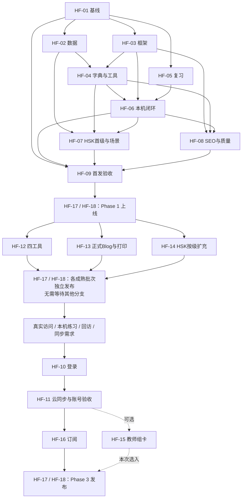

# HanziFun 施工任务总表

2026-10-27 · 对应 SPEC 1.2。**HF-01～09 已完成当前 Phase 1 候选范围验收并正式签发 PASS**；Phase 1 的141个成熟页面索引状态保留为历史基线，当前 Phase 2 HF-10 进度见下文。物理缺音仍保留明确边界。

**开发主线：Phase 1 首发上线 → Phase 2 引流工具与内容 → Phase 3 账号、云同步与订阅。** 任务编号保留，以下按执行阶段排列；HF-12/13/14 已解除对 HF-11 的依赖。

先读 [SPEC](SPEC.md)、[文件架构说明](FILE_ARCHITECTURE.md)、[现状基线](BASELINE.md)、[来源与使用范围](SOURCES.md)。当前 Phase 2 收口批次已完成生产发布；后续按下方最新发布记录进行观察或承接新的明确任务。

Phase 1 保留已确认的 Information、独立 `/stroke-order/` 和 `/pinyin-chart/`；书法暂不规划。字页分 Tier 1 黄金完整版与 Tier 2 标准可用版，达到 Tier 2 即可发布/开放索引；30–50 个 Tier 1 是增强目标，不拦住标准字页上线。HSK 执行 [限定范围放行指令](SPEC.md#hsk-release-policy)，不默认等待第三方书面授权。

## 当前生产发布：AdSense 整改（2026-10-28）

承接 HF-08 的公开内容/导航整改，不改账号、同步、Billing、故事课或旧教学签字。releaseId=`adsense-remediation-2026-10-28` 已于 **2026-10-28 13:09:39 +08:00** 部署生产，版本 `e7ad777b-73c2-421d-9d7c-fa0758ec6374` 承接100%流量；代码 `ff748a2` 已推送GitHub main。[实际发布回执](releases/adsense-remediation-2026-10-28/deployment.json)。下方旧生产记录保留历史。

- [x] 生成 [完整整改方案、18项Unknown确认方法及分阶段复检清单](ADSENSE-REMEDIATION-2026-10-28.md)，区分工具建议与Google官方政策。
- [x] 一棵响应式导航、移除顶部Sign in/Pricing及重复CTA；页脚补Privacy/Terms/About/Contact/Sources；字页和场景补面包屑。
- [x] `/scenarios/`及快/六/星扩写；新增两篇完整学习指南、更新Journal入口；六内容页正文约1059–1451英文词（排除导航、隐藏面板和按钮）。
- [x] 四信任页改为实质正文；Owner补充署名John Ling、邮箱hanzifun.online@gmail.com，已写入`site/publisher.json`并统一显示在四页，Contact缺少渠道提示已消失。四页已上线published/index,follow。pub-ID仍空，默认不出假ads.txt/广告请求。
- [x] 更新后生产构建2826文件、411英文页、365 index/46 noindex、Sitemap365；163/163测试PASS、SEO errors=[]；Chrome156十二类页面axe零违规、60档布局无溢出、菜单/焦点/无JS通过。[证据](evidence/adsense-2026-10-28/summary.json)。
- [ ] Owner核对新正文与政策、确认邮箱可实际收信；本轮未代发测试邮件。
- [ ] 其余336字页未达到本次800词编辑目标；逐页判断后扩写/合并/精确noindex，不能仅凭字数判违规。五场景叶页及两个子入口继续按方案做深。
- [ ] 真实AdSense账号/域名/验证/审核、pub-ID与线上ads.txt、适用地区认证CMP和儿童投放策略由Owner确认。当前全站无广告，不以年龄提示或子域名替代处理。
- [x] Cloudflare实际部署、23项生产HTTP/正文hash/索引/旧入口/音频核验通过；线上Sitemap365，John Ling与邮箱在四信任页显示正确，代码已push GitHub main；TASKS/PROGRESS及发布回执单独提交同步。
- [ ] 24小时/7天错误反馈及Google实际收录观察由Owner按需继续；没有创建自动监控，未把可索引当成已收录。

## 上一轮生产发布（Phase 2收口，2026-10-28收尾）

- [x] Owner 明确授权本次构建、校验、Cloudflare部署与GitHub推送；生产构建、SEO、161/161测试重新通过。
- [x] releaseId=`phase-2-closeout-2026-10-27`；代码提交 `c047d1c` 已推送GitHub main；实际Cloudflare版本 `cd058ccd-a054-440f-b180-6fb6db6f9cd6` 100%上线（2026-10-27 23:58:57 +08:00）。
- [x] 2026-10-28 00:00线上HTTP核验：约2.1秒完成，Sitemap **358 URL**，三新场景200 / index,follow / 自指canonical，内容和线上CSS/JS与本地生产包hash一致。
- [x] 发布清单、实际版本、验收、上一版本回滚说明与线上回执已持久化于 [发布目录](releases/phase-2-closeout-2026-10-27/manifest.json)。保留旧学习key及个人未跟踪文件。
- [ ] 后续观察：Owner按需检查24小时/7天错误反馈与搜索抓取；未冒充已完成观察或Google实际收录，未创建自动监控。线上回滚命令已核实但未主动演练切回旧生产。

## 当前正式签发（2026-10-26）

HF-02、HF-04、HF-07、HF-08、HF-09 均 Completed / PASS。详见 [正式签发记录](acceptance/phase-1-signoff.md) 与 [最终验收报告](acceptance/phase-1.md)。以下各包旧执行状态保留为历史，已由本次签发取代：126核心字批准，213补充字教学编辑仍为空并保留预览，物理缺音保持不可播；后续HF-14补齐，不阻断成熟页面文本发布。HF-17/18真实生产部署尚未执行。

## Phase 2 当前执行项（2026-10-27）

用户明确启动 **[HF-10（Phase 2 补充字教学管道）](phase-2-plan.md)**，承接 HF-14 的现有字库补齐。本次命名与原 `HF-10-auth`（Phase 3 登录）区别记录，不重编号历史任务、不启动登录/同步/Billing。A-D 四批共213字已按各批独立审核决定签发为本地 `published`；本地生产 Sitemap 为354条。没有据此声称实际生产部署完成。

- [x] 盘点子任务：213唯一字、逐字基础字段/教学缺项/结构风险、Schema模板及可重复审计脚本。
- [x] 四批计划：A54、B53、C53、D53；[完整计划](phase-2-plan.md)、[稳定ID与批次](hf10-batches.json)、[逐字盘点](hf10-inventory.json)。
- [x] 教学注入器 `inject-phase2-batch.mjs`：默认 dry-run；支持独立 `--reading-selections` / `--structure-notes`；覆盖Schema、批次、读音、字词包含、结构核对及覆盖校验。
- [x] Batch A · `hf10-phase2-a`：54字已按独立审核决定逐字绑定内容哈希并发布；用户报告已部署，线上状态未独立核验。
- [x] Batch B · `hf10-phase2-b`：53字独立注入与签发；修正后的「五」meaning=`five`；签发记录见 `evidence/hf10/batch-b-release.json`。
- [x] Batch C · `hf10-phase2-c`：53字独立注入与签发；签发记录见 `evidence/hf10/batch-c-release.json`。
- [x] Batch D · `hf10-phase2-d`：53字独立注入与签发；签发记录见 `evidence/hf10/batch-d-release.json`。
- [x] 内容状态复核：四批分别为54/53/53/53条；213条审核均接受、内容完整且哈希匹配；354个页面 index，47个 noindex；`releaseId=phase-2-hf10-a-d-2026-10-27`。
- [ ] 运行环境补验：`validate-mvp-gate` 的 tests、benchmark、data、HSK、production/repeat/staging/local 构建均 PASS；Workers HTTP 因 `127.0.0.1` `listen EPERM` FAIL，Chrome 浏览器验收仍未完成。完整 MVP 总门控未全绿。

本轮 `npm test` **151/151 PASS**；`HF_SITE_ENV=production npm run build:site` PASS（1546个公开文件、401个英文页、354 index/47 noindex）；`node scripts/validate-seo-quality.mjs` PASS（354条 Sitemap URL、402个 JSON-LD、`errors=[]`）。`node scripts/validate-mvp-gate.mjs` 因上述本机端口限制 FAIL / exit 1。原 HF-10-auth 仍属 Phase 3 待执行；本轮未 push、commit 或部署。

## HF-11 / HF-12 Phase 2 用户指定工作包（2026-10-27）

本轮命名以用户明确范围为准，与下方历史 HF-11-sync / HF-12-culture-tools 分开，不启动账号、同步或文化工具。

- [x] [HF-11 音频工程](tasks/HF-11-audio-phase2.md)：410 音节 / 1323 声调入口全点亮，1268 个哈希验证静态录音；单字/例词/例句/HSK/场景/闪卡接入播放、停止与中文语音回退。
- [x] 浏览器 1268/1268 MP3 可解码且非静音，7 类页面 axe 零违规、21 档布局通过；已修复换卡停止与 token 练习精确返回。
- [x] HF-11 **Completed / PASS**：Owner 已完成真机实际试听，正式接受 1268 静态 MP3 + 中文设备语音平滑回退。57 读音与 738 组词句维持回退；腾讯云补录 Deferred，历史 TLS 不再是当前阻塞项。见 [音频签收](acceptance/phase-2-hf11-audio-signoff.md)。
- [x] [HF-12 场景/二级核心工程](tasks/HF-12-scenarios-level2-phase2.md)：机场交通、酒店入住、超市购物各 5 句；86 个有锁定源证的 HSK 2.0 二级新增词（150 增量中的子集），联通现有字页及原稳定练习卡。
- [x] 新二级词表与三场景发布；收口生产构建 2824 文件 / 409 英文页，**358 index / 51 noindex，Sitemap 358 URL**；`npm test` **161/161 PASS**；SEO `errors=[]`。
- [x] HF-12 **Completed / PASS（当前范围）**：Owner 独立人工语言审核与真机验收通过，共 15 句。见 [签收包](acceptance/phase-2-hf12-language-review.md)；绑定当前内容 SHA-256，三个精确路由 published / index,follow，签名过期会拒绝构建。
- **Deferred / Backlog（后续阶段）**：剩余 64 个 HSK 2.0 二级词；已纳入 86 词保持原样，与当前交付解耦。HSK 3.0 二级仍不在本轮范围。
- [x] 学习记录 UI：统计/复习/续练/历史/导入分组、胶囊按钮、历史自由重练与分页边界、折叠旧数据细节；未改 Repository、SRS 或持久化契约。
- [x] 五行卡片：金木水火土完整，含拼音、英文义、部件与例字；所有十个链接指向已审核发布的详情。金/土未在字库独立收录，分别经例字钱/地进入字典，无新增缺失路由。
- [x] 浏览器复验：HF-06 原 18 项回归 PASS；新增 5 组交互、3 页 × 5 宽度无溢出，axe 零违规。见 [收口证据](evidence/phase2-closeout/verification.json)。

完整证据和限制见 [HF-11/HF-12 验证](HF-11-HF-12-VERIFICATION.md)。原 HF-10 的 213 字批次签字保留；本轮未提交、推送或部署。

## HF-02 双「睛」身份/音频映射复核（2026-10-27）

- [x] 排查用户报告的 `char:773c5b` 失败：修改前数据基座 11/11 PASS，本机未复现；现有第19/87位「睛」均为 `char:775b`，`char:773c` 是「眼」，数据与生成器无漂移。
- [x] 校验器按原始字形校验每张卡的 characterId / itemId / readingId / audio 归属，并明确报出字段和教学位置；重复「睛」音频须与旧 manifest URL 一致。
- [x] 在原用例增加 `char:773c5b`、错误「眼」身份、itemId、读音和音频的拒绝回归；不放宽断言、不改正式数据/审批/稳定ID。
- [x] 定向测试11/11，全量 **159/159 PASS**；生产模式 `npm run build:site && npm test` 顺序验证通过（2824文件，54个noindex页）；本轮更新交接记录，未提交或部署。

## 工作包索引

P0 为核心、数据保护与发布关口；P1 为当前阶段主线；P2 为可选扩展。优先级不能越过阶段：账号相关 P1 仍在 Phase 3。每份任务保留独立范围、交付、步骤、验收与执行提示。

| ID / 工作包 | 优先级 | 阶段 | 硬依赖 | 主要交付 |
|---|---|---|---|---|
| [HF-01 基线整合、资产保全与施工契约](tasks/HF-01-baseline.md) ✅已完成 | P0 | Phase 1 基线 | 无 | 统一基线、原型保全、数据/路由契约 |
| [HF-02 字典、笔顺数据与来源管线](tasks/HF-02-data-foundation.md) ✅Completed / PASS（2026-10-26人工签发） | P0 | Phase 1 | HF-01 | 126 字/Tier、Information、拼音/笔画；HSK 范围来源 |
| [HF-03 C 方案框架、七段首页与路由](tasks/HF-03-site-shell.md) ✅已完成（2026-10-25） | P0 | Phase 1 | HF-01 | 七段首页、导航、静态路由/隔离 |
| [HF-04 真实字典、搜索与视觉笔顺闭环](tasks/HF-04-dictionary.md) ✅Completed / PASS（2026-10-26人工签发；缺音诚实保留） | P0 | Phase 1 | HF-02、HF-03 | Tier 2 字页、Tier 1 增强、独立笔顺页与拼音表 |
| [HF-05 复习调度与闪卡会话组件](tasks/HF-05-review-engine.md) ✅独立验收完成（2026-10-25） | P0 | Phase 1 | HF-01 | interval-v1、会话状态机与组件 |
| [HF-06 游客持久化、学习中心与旧记录导入](tasks/HF-06-guest-learning.md) ✅已完成（2026-10-26） | P0 | Phase 1 | HF-03、HF-04、HF-05 | 本机存储、学习中心、无损导入 |
| [HF-07 HSK 首级真实字库与两场景连接](tasks/HF-07-hsk-scenarios.md) ✅Completed / PASS（2026-10-26文本签发；补充字草稿/缺音保留） | P1 | Phase 1 | HF-02、HF-04、HF-06 | 两版 HSK 1 级、餐厅/商务场景 |
| [HF-08 公开页 SEO、性能与无障碍收口](tasks/HF-08-seo-quality.md) ✅Completed / PASS（2026-10-26负责人人工签收） | P0 | Phase 1 | HF-03、HF-04、HF-06 | 按质量放行索引、可见 FAQ、性能/无障碍 |
| [HF-09 MVP 闭环验收与中文迁移演练](tasks/HF-09-mvp-gate.md) ✅Completed / PASS（2026-10-26正式签发） | P0 | Phase 1 发布前 | HF-01、HF-06、HF-07、HF-08 | 首发候选验收，交 HF-17/18 发布 |
| [HF-12 四项文化工具的受控首版](tasks/HF-12-culture-tools.md) | P1 | Phase 2 | HF-09 | 四工具，浏览器运算/静态数据、本机收藏 |
| [HF-13 正式 Blog、场景编辑与打印资源](tasks/HF-13-editorial.md) | P1 | Phase 2 | HF-09 | 首批 3–5 篇正式文章、两组打印卡 |
| [HF-14 HSK 全量覆盖与学术索引扩展](tasks/HF-14-hsk-expansion.md) | P1 | Phase 2 起持续扩充 | HF-07、HF-09 | 先扩至两版 2 级，后逐级发布；Tier 2 为默认 |
| [HF-10 真实登录、账号权限与服务配置](tasks/HF-10-auth.md) | P1 | Phase 3 | HF-09；另须阶段启动依据 | 真实身份、权限、服务配置 |
| [HF-11 游客转账号、跨设备同步与 Phase 3 账号验收](tasks/HF-11-sync.md) | P1 | Phase 3 | HF-06、HF-10 | 游客合并、双设备同步与账号验收 |
| [HF-16 定价、测试支付与服务端权益](tasks/HF-16-billing.md) | P1 | Phase 3 | HF-11 | 订阅、账单、退款/取消与权益 |
| [HF-15 教师私人组卡与教材映射边界](tasks/HF-15-teacher-decks.md) | P2 | Phase 3 可选 | HF-07、HF-11 | 私人卡组、历史版本与打印 |
| [HF-17 按发布范围综合验收与回滚准备](tasks/HF-17-release-gate.md) | P0 | 每次发布 | HF-09 + 所选批次验收 | 按 releaseId 的验收/回滚证据 |
| [HF-18 最终迁移、授权发布与运行交接](tasks/HF-18-migration-release.md) | P0 | 每次发布 | HF-17 | 实际上线、生产冒烟与交接 |

## 依赖与执行顺序

下面展示发布主线；具体模块硬依赖以上表及各任务为准。HF-17/18 在每个发布节点复用，节点代表不同 releaseId。

1. HF-01 后，HF-02/03/05 可按文件边界分工；HF-04/06 接成真实本机学习闭环。
2. HF-07/08 可并行；HF-09 通过后继续 HF-17/18，**Phase 1 必须以实际上线收尾**，不等账号或文化工具。HF-03 已完成；HF-02/04/07/08/09 已于2026-10-26按负责人声明关闭人工验收；成熟页已放行索引，实际部署交HF-17/18。
3. Phase 2 的 HF-12/13/14 仅依赖已有公开站和本机接口，不依赖登录、云数据库或运行时 AI。可以分别准备和分批发布；一个工具、一篇合格文章或一个 HSK 等级的完成不冒充整个包完成。
4. HF-14 首批扩至两版 2 级，随后逐级扩充。HF-13 先发布至少 3 篇、目标 3–5 篇；4–5 篇和高级 HSK 不拦住已完成批次。
5. Phase 3 在 Phase 2 已有上线成果、真实使用与同步需求形成后启动。每天数百自然访客为参考，结合约 28 天趋势、练习完成/回访和用户反馈记录决策，不把单日点击当日活，也不写成自动采购/收费触发器。技术依赖 HF-09 不表示立即跳过 Phase 2；用户后续明确调整阶段时同步记录即可。
6. Phase 3 主线 HF-10→11→16；HF-15 为可选，不要求先完成高级 HSK 或教师系统才能发布订阅。出售的具体能力必须已经交付，免费基础学习继续可用。

同一工作树不能并行改同一组共享文件；契约变化先更新接口与接入说明。这里只说明开发安排，不代表已启动多 agent 或创建新对话。

## 阶段验收与输入输出

| 关口 | 输入 | 可验收输出 | 不可冒充 |
|---|---|---|---|
| Phase 1 基线 / HF-01 | 两树源码、原型与旧记录 | 八课统一基线、资产保全、稳定契约 | 原型已在 Git 中保存 |
| Phase 1 学习闭环 / HF-04～06 | 126 字至少 Tier 2、框架/调度 | 字页→笔顺→闪卡→本机保存→刷新；拼音表可用 | 全字 Tier 1、云同步或完整课程 |
| Phase 1 发布前 / HF-09 | HF-01～08 | 双 HSK 首级、两场景、中文兼容、SEO/质量证据 | 实际已上线 |
| Phase 1 上线 / HF-17→18 | 首发候选、可用部署环境与适用授权 | 生产 200、成熟页可索引、sitemap、线上闭环与回滚 | Google 必然立即收录 |
| Phase 2 / HF-12/13/14 + 发布 | 公开站、本机接口、真实数据内容 | 四工具、3–5 篇 Blog、HSK 首批 2 级及后续逐级上线 | 后端是前置、首批等于全量完成 |
| Phase 3 / HF-10/11/16 + 发布 | 上线反馈与阶段依据、真实身份/权限 | 游客合并、跨设备同步、订阅与取消/退款 | 仅登录布局、未配置的真实收款 |
| 每次 HF-17/18 | 当次 release manifest 与批次证据 | 范围验收、迁移/回滚、生产检查与交接 | 未测 p75、未执行的 24 小时/7 天观察 |

## SPEC 要求映射

每项要求至少有施工归属与对应关口；更细验收见工作包中的复选项。整体要求编号以 SPEC 为唯一来源。

| SPEC | 主要施工包 | 集成/发布复核 |
|---|---|---|
| [REQ-01](SPEC.md#req-01) | [HF-01](tasks/HF-01-baseline.md) | [HF-09](tasks/HF-09-mvp-gate.md)、[HF-17](tasks/HF-17-release-gate.md)、[HF-18](tasks/HF-18-migration-release.md) |
| [REQ-02](SPEC.md#req-02) | [HF-03](tasks/HF-03-site-shell.md) | [HF-09](tasks/HF-09-mvp-gate.md)、[HF-17](tasks/HF-17-release-gate.md) |
| [REQ-03](SPEC.md#req-03) | [HF-01](tasks/HF-01-baseline.md)、[HF-03](tasks/HF-03-site-shell.md)、[HF-04](tasks/HF-04-dictionary.md)、[HF-07](tasks/HF-07-hsk-scenarios.md) | [HF-09](tasks/HF-09-mvp-gate.md)、[HF-17](tasks/HF-17-release-gate.md)、[HF-18](tasks/HF-18-migration-release.md) |
| [REQ-04](SPEC.md#req-04) | [HF-01](tasks/HF-01-baseline.md)、[HF-03](tasks/HF-03-site-shell.md)、[HF-10](tasks/HF-10-auth.md) | [HF-09](tasks/HF-09-mvp-gate.md)、[HF-17](tasks/HF-17-release-gate.md) |
| [REQ-05](SPEC.md#req-05) | [HF-01](tasks/HF-01-baseline.md)、[HF-02](tasks/HF-02-data-foundation.md)、[HF-04](tasks/HF-04-dictionary.md)、[HF-12](tasks/HF-12-culture-tools.md)、[HF-14](tasks/HF-14-hsk-expansion.md) | [HF-07](tasks/HF-07-hsk-scenarios.md)、[HF-09](tasks/HF-09-mvp-gate.md)、[HF-17](tasks/HF-17-release-gate.md) |
| [REQ-06](SPEC.md#req-06) | [HF-04](tasks/HF-04-dictionary.md)、[HF-14](tasks/HF-14-hsk-expansion.md) | [HF-09](tasks/HF-09-mvp-gate.md)、[HF-17](tasks/HF-17-release-gate.md) |
| [REQ-07](SPEC.md#req-07) | [HF-02](tasks/HF-02-data-foundation.md)、[HF-04](tasks/HF-04-dictionary.md) | [HF-09](tasks/HF-09-mvp-gate.md)、[HF-17](tasks/HF-17-release-gate.md) |
| [REQ-08](SPEC.md#req-08) | [HF-02](tasks/HF-02-data-foundation.md)、[HF-07](tasks/HF-07-hsk-scenarios.md)、[HF-14](tasks/HF-14-hsk-expansion.md)、[HF-15](tasks/HF-15-teacher-decks.md) | [HF-09](tasks/HF-09-mvp-gate.md)、[HF-17](tasks/HF-17-release-gate.md) |
| [REQ-09](SPEC.md#req-09) | [HF-05](tasks/HF-05-review-engine.md)、[HF-06](tasks/HF-06-guest-learning.md) | [HF-09](tasks/HF-09-mvp-gate.md)、[HF-11](tasks/HF-11-sync.md)、[HF-17](tasks/HF-17-release-gate.md) |
| [REQ-10](SPEC.md#req-10) | [HF-05](tasks/HF-05-review-engine.md)、[HF-06](tasks/HF-06-guest-learning.md)、[HF-11](tasks/HF-11-sync.md) | [HF-09](tasks/HF-09-mvp-gate.md)、[HF-17](tasks/HF-17-release-gate.md) |
| [REQ-11](SPEC.md#req-11) | [HF-01](tasks/HF-01-baseline.md)、[HF-06](tasks/HF-06-guest-learning.md)、[HF-11](tasks/HF-11-sync.md) | [HF-09](tasks/HF-09-mvp-gate.md)、[HF-17](tasks/HF-17-release-gate.md)、[HF-18](tasks/HF-18-migration-release.md) |
| [REQ-12](SPEC.md#req-12) | [HF-10](tasks/HF-10-auth.md)、[HF-11](tasks/HF-11-sync.md)、[HF-16](tasks/HF-16-billing.md) | [HF-17](tasks/HF-17-release-gate.md) |
| [REQ-13](SPEC.md#req-13) | [HF-05](tasks/HF-05-review-engine.md)、[HF-11](tasks/HF-11-sync.md) | [HF-17](tasks/HF-17-release-gate.md) |
| [REQ-14](SPEC.md#req-14) | [HF-07](tasks/HF-07-hsk-scenarios.md)、[HF-13](tasks/HF-13-editorial.md)、[HF-14](tasks/HF-14-hsk-expansion.md) | [HF-09](tasks/HF-09-mvp-gate.md)、[HF-17](tasks/HF-17-release-gate.md) |
| [REQ-15](SPEC.md#req-15) | [HF-12](tasks/HF-12-culture-tools.md) | [HF-17](tasks/HF-17-release-gate.md) |
| [REQ-16](SPEC.md#req-16) | [HF-13](tasks/HF-13-editorial.md) | [HF-17](tasks/HF-17-release-gate.md) |
| [REQ-17](SPEC.md#req-17) | [HF-15](tasks/HF-15-teacher-decks.md) | [HF-17](tasks/HF-17-release-gate.md) |
| [REQ-18](SPEC.md#req-18) | [HF-16](tasks/HF-16-billing.md) | [HF-17](tasks/HF-17-release-gate.md)、[HF-18](tasks/HF-18-migration-release.md) |
| [REQ-19](SPEC.md#req-19) | [HF-03](tasks/HF-03-site-shell.md)、[HF-07](tasks/HF-07-hsk-scenarios.md)、[HF-08](tasks/HF-08-seo-quality.md)、[HF-13](tasks/HF-13-editorial.md)、[HF-14](tasks/HF-14-hsk-expansion.md) | [HF-09](tasks/HF-09-mvp-gate.md)、[HF-17](tasks/HF-17-release-gate.md)、[HF-18](tasks/HF-18-migration-release.md) |
| [REQ-20](SPEC.md#req-20) | [HF-03](tasks/HF-03-site-shell.md)、[HF-04](tasks/HF-04-dictionary.md)、[HF-08](tasks/HF-08-seo-quality.md)、[HF-11](tasks/HF-11-sync.md) | [HF-09](tasks/HF-09-mvp-gate.md)、[HF-17](tasks/HF-17-release-gate.md)、[HF-18](tasks/HF-18-migration-release.md) |
| [REQ-21](SPEC.md#req-21) | [HF-02](tasks/HF-02-data-foundation.md)、[HF-06](tasks/HF-06-guest-learning.md)、[HF-08](tasks/HF-08-seo-quality.md)、[HF-10](tasks/HF-10-auth.md)、[HF-11](tasks/HF-11-sync.md)、[HF-12](tasks/HF-12-culture-tools.md)、[HF-13](tasks/HF-13-editorial.md)、[HF-15](tasks/HF-15-teacher-decks.md)、[HF-16](tasks/HF-16-billing.md) | [HF-17](tasks/HF-17-release-gate.md)、[HF-18](tasks/HF-18-migration-release.md) |
| [REQ-22](SPEC.md#req-22) | [HF-09](tasks/HF-09-mvp-gate.md)、[HF-11](tasks/HF-11-sync.md)、[HF-16](tasks/HF-16-billing.md)、[HF-17](tasks/HF-17-release-gate.md) | [HF-18](tasks/HF-18-migration-release.md) |
| [REQ-23](SPEC.md#req-23) | [HF-01](tasks/HF-01-baseline.md)、[HF-08](tasks/HF-08-seo-quality.md)、[HF-09](tasks/HF-09-mvp-gate.md)、[HF-17](tasks/HF-17-release-gate.md) | [HF-18](tasks/HF-18-migration-release.md) |

## 真正的决策与阻断处理

- Phase 1 以正式上线为目标；HSK 只使用已确认的字/词头、版本与等级归属范围，按 SPEC 指令继续，不默认等待第三方书面授权。来源/版本、署名和具体条款冲突由开发记录，冲突只处理受影响部分。
- Phase 3 账号开工须有 D-05 阶段启动依据，随后落实 D-01/D-02 的地区、预算和经营/支持信息；沿用成人/家长/教师账号范围，已有授权和确认不重复询问。
- 收费开工前才确定 D-04 的价格、币种、免费权益和商户主体；无需现在为它推迟免费闭环。
- 首次切换生产的范围/窗口是 D-03；先把 HF-17 候选和迁移包做成可审阅结果，再处理真正缺少的最终部署授权。

前置失败应记录具体缺项、已完成交付和可继续的独立部分。不能把 pending 任务标已完成，也不能因一个外部配置缺失停下所有不依赖它的工作。

## 建议第一条开发请求

直接打开 [HF-01](tasks/HF-01-baseline.md) 末尾的“后续开发执行提示”并复制。第一项完成后按上面的依赖图推进；本轮不自动创建开发对话或向其他对话发消息。

## HF-02 执行状态（2026-10-25）

126 字数据、来源锁/许可、按字笔画、108 教学位置映射、拼音候选范围与缺音报告、HSK 导入契约已交付；`npm test` 58/58、数据验证及离线重建一致性通过。本地浏览器抽查 22 字。人工全英义/读音/简繁语境复核、拼音教学声调及音频逐项听审尚未关闭，因此不标整个包验收完成。详情与精确切入点见 [HF-02 验收记录](HF-02-VERIFICATION.md) 和 [数据接口说明](../../data/README.md)。

## HF-04 执行状态（2026-10-25）

126 个静态字页与 Information、真实按字笔顺和完整静图、410 音节范围表、拼音/部首索引、八对比较、搜索分包及发布审核门槛已接入 HF-03 外壳；126 份原创例词/句与短助记已做 Codex 快审，人工验收仍为 pending。`npm test` 77/77，构建 880 文件、两次构建字节一致，完成本地浏览器与五档宽度抽查。HF-02 人工内容/拼音/音频验收及 HF-05/06 真实学习联调尚未关闭，不标全部完成或 126 字已验收 Tier2，release 保持 noindex 预览。精确证据与后续入口见 [HF-04 验收记录](HF-04-VERIFICATION.md)。

## HF-05 执行状态（2026-10-25）

interval-v1 调度、UTC/IANA 额度、UUID/revision 事件与确定性重放、冻结会话/游标、独立闪卡组件及未保存重试/恢复导出已完成。`npm test` 98/98（原77+新增21）；真实 Chrome 隔离夹具的键盘、焦点、暂停刷新恢复、保存失败与重试、完成刷新去重及五档宽度通过；隔离构建880文件且不发布测试夹具。HF-06 优先按 Repository 契约接 localStorage 确定性快照、旧记录只读导入和隐私模式降级；真实四组卡/字典入口落盘联调仍待 HF-06，不宣称完整学习闭环。见 [HF-05 验收](HF-05-VERIFICATION.md) 与 [接入说明](HF-05-INTEGRATION.md)。

## HF-06 执行状态（2026-10-26）

localStorage 确定性 Repository、特性检测/共享写者协调/乐观校验、四组真实卡与字典 saveCharacter/startCharacterPractice、本机学习概览/收藏/历史分页/续练、三旧源预览去重与导出恢复已交付。`npm test` 112/112；真实 Chrome 有锁/无锁/混合能力双标签、刷新/关页续练、实际配额满/失败重试/临时导出恢复、当前已载会话断网通过。HF-04 学习联调缺口关闭，人工内容/拼音/音频缺口仍保留，release 仍 noindex。大日志测试明确受 localStorage 容量限制，未宣称10000事件可真实落盘。证据与下个切入点见 [HF-06 验收](HF-06-VERIFICATION.md)。

## HF-07 执行状态（2026-10-26）

两版首级源事实已全量映射：HSK2 150词/174派生字，HSK3 300词/246认读字及100个一级～二级联合书写字（不伪拆一级）。从HF-02锁源自动提取213个补充字，核心126保留，站点并集339；各清单分母/核心交集/教学审核分开。餐厅和商务各3句、词界释义、精确返回、当前组、字典/独立笔顺/受控卡组/本机收藏已接通。npm test 119/119、HSK验证及确定性重建、HF07真实Chrome7组闭环和HF06回归18项通过。3个HSK主范围页可索引；补充字教学草稿/两场景音频缺失保持预览。按用户允许的精简模板与待审核方案交付，不冒充全量Tier2或人工听审完成。证据/遗留/精确切入点见 [HF-07验证](HF-07-VERIFICATION.md)。

## HF-08 执行状态（2026-10-26）

三个国王静态 DOM 契约、发布/环境索引联动、self-canonical/sitemap/robots、全部 JSON-LD 解析和字段校验、六 FAQ、资源预算及构建必经门控已交付。npm test 127/127；401 英文页/354 核心页/402 JSON-LD，production 仅3个既有 HSK页入 sitemap，staging/local为空；缺省 local 安全 noindex。Chrome155+axe4.10.3 在16类页面零违规、65档布局及5模板200% CSS放大、键盘/无JS通过；本机Workers4.152.0真实404、旧中文301、故事默认307保留query与staging头通过。4模板三轮4G实验室LCP/CLS中位数达标、构建1546文件两次字节一致。跨浏览器/真机/真实屏幕阅读器与原生缩放仍未验收，HF-02/04/07人工及音频缺口保留，未部署。证据与精确切入点见 [HF-08验收记录](HF-08-VERIFICATION.md)。

## HF-09 执行状态（2026-10-26）

主目录main交付总门控、逐项内容hash审批、6个核心/11个补充字批次模板及精确路由放行工具；213补充字统一禁发改为Tier2完整性+逐项人工签字门槛，未补造内容或批准。npm test 133/133；数据/HSK、四构建确定性、18项本机Workers HTTP、HF06/07/08浏览器及四种水搜索/跨origin文件迁移/八课全程通过。工程PASS，完整候选仍BLOCKED：126/213字人工验收均0，拼音/音频/场景/故事/真机与跨浏览器/读屏缺口保留。见[总报告](acceptance/phase-1.md)、[人工清单](acceptance/phase-1-checklist.md)。未部署；大构建/截图/备份仅存忽略的.cache，Git只含轻量证据。

## UI/UX 修订完成（2026-10-26）

- [x] HF-05/06：正面 Familiar/Again 按钮及数字 1/2 可直接评价并推进游标；保留防连点、失败重试、完成去重与续练。
- [x] HF-05：桌面 24rem／手机 21rem 固定卡高，楷体大字正面、背面密度调整与内部滚动。
- [x] HF-03/06/08：闪卡工具栏 Learning History SVG 胶囊，以及共享桌面/移动导航 My Progress → `/account/`。
- [x] 中文首页/故事播放器头部 English 返回 `/`；只修改导航及样式，不变更课程内容或视听资源。
- 验证：`npm test` 138/138；`npm run build:site` 更新主目录 dist（1546文件）；Chrome 闪卡回归、实际页面六档宽度及 HF-08 质量检查通过。原人工发布门槛保持 pending。详情见 PROGRESS 记录 11。

## HF-08 学习者正文清理（2026-10-26）

- [x] 字典/补充字/HSK/拼音/场景和共享正文移除管线审核、分级、缺音长句及可见调试定位。
- [x] 缺音静默降级，自动门控与原测试同步；139/139测试通过，生产141 index / 260 noindex及354核心页SEO结构保持。
- [x] 底层schema、审核输入和release索引策略不变；未改用户未跟踪文件。
- [ ] 本轮浏览器复验受环境限制：本地监听EPERM且Chrome工具不可用，留待可用环境补测。
- 审计、文件范围与验证边界见 [正文清理验证](HF-08-LEARNER-COPY-VERIFICATION.md)。

- [ ] Git提交受环境阻断：`.git/index.lock` 写入报 Operation not permitted，改动保留main工作目录，尚未提交。
